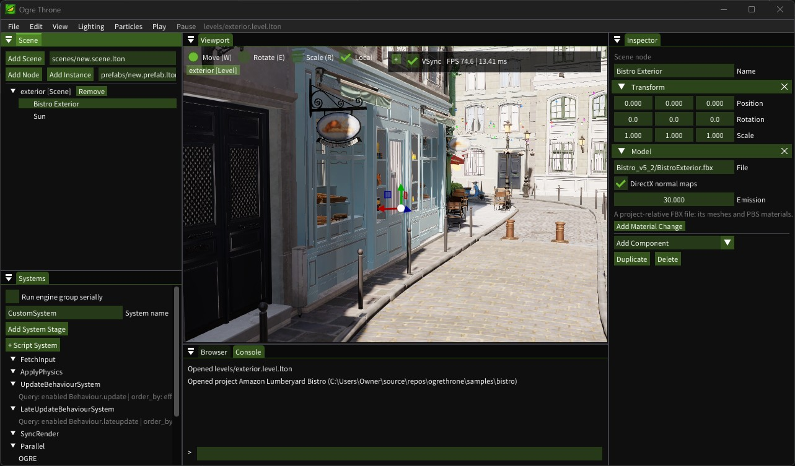

# Ogre Throne

A C++ game engine using OGRE-Next 4.0 development sources for Vulkan graphics,
Box3D for physics, L^ for scripting, Dear ImGui for editor UI, Colibri for
in-game UI, OIS for device input, and SoLoud + Steam Audio for sound. The name is currently a working name.



## Checkout

```sh
git clone --recurse-submodules <this-repository-url>
# For an existing checkout:
git submodule update --init --recursive
```

Source dependencies live in `third_party/` as submodules. The parent repository records
exact commits; ordinary builds never update them. Colibri's nested `sds_library`
submodule is required. The original sibling checkouts remain independent.

## Windows

Requirements: Visual Studio 2026 with Desktop development with C++ and C++ Clang
tools for Windows, CMake 3.25+, Ninja, and the LunarG Vulkan SDK (headers and loader
library). Open an **x64 Native Tools Command Prompt** or an x64 Developer PowerShell
before configuring or building with Clang. The standard Windows presets use
`clang-cl` and Ninja Multi-Config, retaining the MSVC ABI, standard library and
static CRT. Visual Studio's LLVM directory is added to PATH by the preset.
A Vulkan-capable GPU and driver are required to run graphics.

```powershell
cmake --preset windows -DOGRE_VULKAN_SDK=C:/VulkanSDK/<installed-version>
cmake --build --preset windows-debug --parallel 8
ctest --preset windows-debug
./out/build/windows-clang-ninja/bin/Debug/ogrethrone.exe
```

The executable embeds a manifest (visual styles, per-monitor DPI awareness, UTF-8)
and the application icon `media/ogrethrone.ico`; after editing the
`media/ogrethrone<size>.png` images, run `tools/make-icon.ps1` to repack it. The
title bar follows Windows' light or dark app mode.

`VULKAN_SDK` can also locate the SDK. A terminal opened before SDK installation
may need restarting, or use the explicit CMake option above.
The pinned glslang submodule is built from source for each configuration, using
the same MSVC runtime as OGRE. SDK shader compiler libraries are not linked.

`ogrethrone` without arguments shows the project launcher: create a project, import
an existing project folder, or click a known one to open it in the editor.
On Windows, **Browse...** beside the import folder or new project's parent folder
opens the native folder picker. Selecting a folder fills the path; cancelling keeps it unchanged.
The editor bundles Noto Sans JP for Japanese project names, paths and text input, with the
common Simplified Chinese characters it lacks from Noto Sans SC (for Chinese asset names);
no system font installation is needed. Their license is in `media/fonts/OFL.txt`.
`ogrethrone <folder>` opens that project directly. The known projects are kept in
`%APPDATA%/OgreThrone/projects.lton` (`$XDG_CONFIG_HOME/ogrethrone/` elsewhere);
removing one from the list leaves its folder alone. File > Close Project returns
to the launcher.

A project is a folder containing `project.throne.lton`:

```text
<project>/
    project.throne.lton   # name and optional mainLevel
    main.lh               # the game's entry point (generated, optional)
    lhat-host.json        # written by the editor for the L^ language server
    assets/               # levels, scenes, prefabs, mixers, scripts, models, textures, sounds
    baked/                # GI bakes, by scene ID
    .throne/              # the editor's cache (asset index); not for version control
```

Files under `assets/` can be arranged freely. Each has a persistent ID: levels, scenes,
prefabs and mixers hold theirs as a top-level `id`, every other file in a `<name>.meta`
beside it, created when the project is opened. Files refer to each other by these IDs, so
moving or renaming one keeps every reference to it; move a file's `.meta` along when moving
it outside the editor. A reference may also be written by hand as a path relative to
`assets/`, which becomes an ID the next time the file is saved. `ogrethrone --resave-assets
<project>` gives every file its ID and rewrites every reference by ID. Paths starting with
`@ogre/` refer to the pinned OGRE sample media. Scripts are read from `assets/` (main.lh from
the project's root) and cannot read files outside it. [`samples/basic`](samples/basic) is a sample project; the VS Code
launch configurations open it or show the launcher.

[`samples/showcase`](samples/showcase) ports the OGRE Forward3D, PBS Materials,
Area Lights and ParticleFX2 scenes to editable Throne levels, and adds one comparing
subsurface scattering and translucency. Open the project and
double-click a level
in the **Browser** (`levels/`). **Lighting** switches Forward3D/Clustered, cluster debug
and Approx/LTC area-light previews. Light and PBS Material components are editable
in Inspector and persist with scenes and prefab overrides. The particle level
includes a fountain, rings, lit/unlit smoke and sphere particles, with edit
preview, Play/Pause/Stop and transparency comparison in **Particles**. A Particle
System component stores its template and optional script file. See the sample's
[README](samples/showcase/README.md) for controls and source attribution.

The editor's dockable panels are Scene, Systems, Inspector, Viewport, Browser and Console
(the layout is kept in `editor.ini` beside the project list).
Scene and Systems scroll sideways when their rows are wider than the panel; the
Inspector wraps its text instead. Dragging the gap between the Inspector's fields and
their labels sets the width of the label column (kept per user in `editor.lton`).

The **Browser** shows `assets/`: its folders as a tree on the left, and the chosen folder's
files on the right, as a grid of tiles (image files show a thumbnail; the slider sizes the
tiles) or as a list, with a breadcrumb and a name filter. Files are shown without their
extension (everything from the first dot, such as `.scene.lton`), which the icon and the
tooltip tell; renaming keeps it, and names made in the Browser cannot hold a dot. Double-clicking a file opens it: a
level replaces the open one, a scene or prefab is edited, a model opens alone, a mixer opens
in the Mixer panel, and anything else (a script, a sound) opens in the operating system's
application for it. Right-clicking a file renames (F2), duplicates (with a new ID), deletes
(Delete; after confirming, references to it show as missing), copies its path or shows it in
Explorer; right-clicking the empty space makes a new folder, level, scene, prefab, mixer or
script. **Refresh** (Ctrl+R) scans `assets/` again for files added or changed outside the
editor; files and folders dropped from Explorer onto the Browser are copied into its folder
and get their IDs at once. Dragging files onto a folder (in either pane) moves them, keeping every reference to
them. Dragging a prefab or model onto the hierarchy or the viewport places it (a scene too, at
the Level step); Add Scene and Add Instance place the scene or prefab selected in the Browser.

The data is split
in three kinds of file, all LTON (L^ Table Object Notation, read by L^ as
effect-free data):

- A **scene** (`*.scene.lton`) is a hierarchy of nodes. A node has an ID, a name
  and a parent, and components, each optional: a **Transform** (local position,
  rotation in degrees applied about X, then Y, then Z, and scale; a node without
  one passes its parent's placement on) and a **Box Primitive** (a unit cube and
  its colour). The Inspector shows one section per component, where a node of the
  edited file can add or remove them. Drag nodes in the Scene panel to reparent
  them, or drop one on the top or bottom edge of another to place it before or
  after it; sibling order is kept. A scene is a prefab (`*.prefab.lton`) extended with scene-wide data.
- A **prefab** (`*.prefab.lton`) is a reusable node hierarchy with a single root
  and its own systems. A node of a scene or prefab can be an *instance* of a
  prefab: it becomes the prefab's root, giving it a name and transform, and
  stores only its overrides of the prefab's properties and system field values.
  Prefabs nest; a prefab that contains itself is reported. A **variant** is a
  prefab file with no nodes, only a `base` prefab and overrides of it.
- A **Behaviour component** holds object-oriented script instances, each with its
  own data and methods. **BehaviourSystems** query and call their phase methods.
  In Inspector it uses the same collapsible section and close button as other
  components. Add it through **Add Component → Behaviour**, then use **Add Script**
  inside the section to attach more scripts.
  Custom systems can also query components or use node references; scenes and
  levels can both hold them. Systems have no transform or scene-hierarchy entry.
- A **level** (`*.level.lton`) holds scene instances and its own systems. The
  same scene can be placed more than once; each instance has its own transform,
  under which all of the scene's nodes lie. A level holds no nodes, no prefab
  instances and no overrides of its own: editing a scene's content at the Level
  step writes to that scene's file, so every instance of it shows the change.
- A **Camera** component keeps a viewpoint: the node's position and orientation (it
  looks along its local -Z, +Y up), with a field of view, near/far clip distances,
  depth of field (a focus distance and an f-stop; 0 keeps everything in focus) and
  **Anti-Aliasing**: **TAA** (the default), **SMAA** or **None**. Alpha hashing and the
  noise of SSAO, SSR and depth of field average out only under TAA; orthographic views
  use SMAA instead. Its Inspector has **Align View to Camera** (the scene view takes its
  position, direction and field of view; the view has no roll) and **Align Camera to
  View** (the node's Transform and field of view take the view's; one undo step). The
  scene view keeps its own clip distances, depth of field and anti-aliasing, edited in
  the level's Inspector. Levels keep no view of their own; `--capture` looks through the
  level's first Camera node, with all of its settings.

Levels, scenes and prefabs are named after their files (`main.scene.lton` shows
as `main [Scene]`; a scene placed twice adds its instance ID). The editor drills
down: at the Level step the hierarchy panel is named **Level** and lists, under a row for
the level itself, the scene instances (inside a scene or prefab it is named **Scene**).
Selecting the level's row shows its Inspector: the scene view's camera (position, rotation
about X then Y, field of view and clip distances), edited there as by navigating; it is not
saved. Selecting a scene instance shows its transform in the Inspector and the gizmo,
and double-clicking one (or a scene file in the Browser) edits that
scene, and double-clicking an instance node (or a prefab file) edits
that prefab. The breadcrumb over the viewport returns to an outer step. Nodes and
systems that come from an instance are drawn in blue; editing them writes an
override, shown in orange with a Revert button. With a node inside an instance
selected, Add Node and Add Instance add
the new node as an override of that instance, also shown in orange; Delete on a
node inside an instance records its removal, which the instance's Inspector
lists with a Restore button. Systems work the same way: + System with an
instance's system or a node inside it selected adds one to that instance, and
Delete on an instance's system records its removal. Add Instance places the prefab selected
in the Browser; a new prefab is made with the Browser's **New Prefab**.
A node's Inspector lists the system fields that refer to it (Referenced by);
clicking one selects that system.
Each override has an Apply button beside its Revert (a property, a component, a
script setting or field of an attachment, a system field, a removal, or a node, system
or attachment the instance added):
it writes that override into the prefab, saving it at once, and removes it from the
instance. The instance's Inspector has Apply All and Revert All for all of them.
When the prefab no longer has what an override names (a node, a system, or a
component), the override is listed in grey under the instance with a Remove button
(and Remove All). These overrides are never removed automatically, so a prefab that is
broken for a while (a branch switch, an undone deletion) does not lose them. The
overrides of an instance whose prefab cannot be read are kept, but not listed.
Unpack in the Inspector replaces an instance with plain nodes holding what it
shows, nested instances included, and copies its systems into the file.
Dragging a node onto a Browser folder saves it there as
`<name>.prefab.lton` and leaves an instance in its place; dragging an
instance makes a variant of its prefab. Dropping a node on an existing prefab
file asks before replacing that prefab with it; dropping an instance on its own
prefab applies the instance's overrides to the prefab. Variants are shown in violet.
Ctrl+S saves the level, its scenes and every opened prefab.

Right-drag looks around in place; hold the right button and use WASD to fly
forward/backward and strafe left/right (initially 5 scene units per second).
Q descends and E ascends along the world's Y axis while flying.
While holding the right button, the wheel adjusts fly speed instead of dollying;
hold Left Shift to double the current speed. Alt+middle-drag
orbits the focus point. A middle-click focuses the nearest rendered surface without
moving the camera; clicking empty space leaves the focus unchanged. Middle-drag
pans, Ctrl+Alt+middle-drag vertically dollies (up moves closer, down moves away),
the wheel dollies outside fly mode, left-click selects a node
and `F` frames it. The selected node shows an ImGuizmo gizmo: W, E and R (or the
viewport toolbar) switch between move, rotate and scale, and Local switches between
the node's own axes and the world's; one drag is one undo step. Ctrl+Z/Ctrl+Y undo/redo, Ctrl+D duplicates a node (with copies of
the systems that refer to it, referring to the copy), Delete
removes the selected node or system, Ctrl+S saves the level and its scenes and
Ctrl+O opens a level. New and Open are undoable; closing the window or the project with
unsaved changes asks to save or discard them (on Windows this also covers the
window's close button). Colibri widgets are not wired yet.
`ogrethrone --smoke` creates a throwaway project, runs the editor on it for three
frames and exits, without touching the project list.
With `BUILD_TESTING=ON`, `ogrethrone --smoke-navigation` replays mouse and keyboard
input against a temporary copy of `samples/physics`, checking surface focus,
empty-space clicks, orbit, looking in place, WASD movement, panning, dolly,
wheel-adjusted fly speed and Left Shift boost.
On Windows it also sends a native Close request during Play and verifies that
rendering and simulation do not run another frame before shutdown. Use
`ogrethrone --smoke-close` for the same checks with the real audio output backend
instead of the null driver. Shutdown stages are recorded in `OgreThrone.log`;
the final OGRE marker is also written to standard error.
**View → Statistics** toggles a viewport overlay showing averaged editor FPS and
frame time, scene node count and active physics body count. Its **− / +** button
switches between the full panel and a single FPS row. Dragging its left or bottom edge
(or the corner between them) resizes it; the size is kept in `editor.lton`. Expanded statistics also
show CPU wall times for UI/scripts, physics, scene copying, render synchronization,
render/present and waiting for simulation. With frame delay, simulation and rendering
overlap; render/present includes GPU/driver/display waits and is not a GPU timestamp. The panel is enabled
by default.

`ogrethrone --profile-physics [project] [output.csv]` profiles a temporary copy of
`samples/physics` by default. It advances at a fixed 1/60 s without the main-loop
sleep, disables VSync for the test, writes per-frame wall times, and reports the
average at 300–329 physics bodies. The default output is `out/physics-profile.csv`.
Use matching Debug/Release builds and compare measured milliseconds; the test's
fixed simulation delta makes the displayed FPS unsuitable for this comparison.
It uses OGRE's native window and message pump. HlmsUnlit shader templates are read
from the pinned `third_party/ogre-next/Samples/Media`, so the executable currently
needs the source tree.

CPU-only checks require neither the Vulkan SDK nor a graphics/audio device:

```powershell
cmake --preset windows-headless
cmake --build --preset windows-headless --parallel 8
ctest --preset windows-headless
```

MSVC remains available for compatibility checks in a separate build directory:

```powershell
cmake --preset windows-msvc -DOGRE_VULKAN_SDK=C:/VulkanSDK/<installed-version>
cmake --build --preset windows-msvc-debug --parallel 4
ctest --preset windows-msvc-debug
```

Use `windows-release` / `windows-msvc-release` to build and test Release, and
`windows-msvc-headless` for CPU checks with MSVC. The MSVC presets use VS 2026;
with VS 2022, override the generator with `-G "Visual Studio 17 2022"` at initial
configuration. Clang and MSVC use independent build trees; old `out/build/windows`
and `out/build/windows-headless` directories are not reused.
The VS 2026 generator requires a CMake version that supports that generator;
the Clang/Ninja presets do not require the ClangCL MSBuild integration component.

The smoke check initializes an L^ VM, simulates a box falling onto a ground plane,
and compares all 180 positions against a second identical run. This verifies
same-build repeatability; it does not establish cross-platform determinism.

Verified locally with Clang 22.1.3 (MSVC ABI), Visual Studio 2026's Windows toolchain,
Vulkan SDK 1.4.363.0 and an NVIDIA GeForce GTX 1660 Ti: Debug and Release builds,
all three CTest checks, and three-frame Vulkan runs passed. Both graphics runs
compiled the ImGui vertex and fragment shaders successfully; Release also passed
the audio device playback check. The separate MSVC headless preset passed all
three CTest checks. CI is configured to check both Windows compilers.

## VS Code

Open the repository root as a folder. The shared `.vscode` configuration recommends
CMake Tools and C/C++, uses CMake Presets for build flags and IntelliSense, and
lets CMake Tools initialize the Visual Studio developer environment on Windows.
Select the `windows` configure preset and a build preset, then
select `ogrethrone` with **CMake: Set Debug Target** (or the launch-target picker).
`Ctrl+Shift+B` builds the active preset; **Tasks: Run Test Task** runs CTest.
The **Regenerate samples/basic/lhat-host.json** task builds the editor and rewrites
the sample's host API file with `--dump-host-api`.
The supplied Windows F5 configuration builds and launches the selected CMake
target using the active build preset, with the Visual Studio debugger. To switch,
open **Ctrl+Shift+P → CMake: Select Build Preset** and choose `windows-debug`
(unoptimized debugging), `windows-release` (optimized), or `windows-relwithdebinfo`
(optimized with debug symbols). Then press F5. If the configure preset has not
been selected yet, use **CMake: Select Configure Preset → windows** first.
F5 uses CMake Tools' `cmake.buildBeforeRun` incremental build check; the launch
configuration does not add a second build task. With no source changes, it should
report no work rather than recompile the editor.

This engine currently has no C# component. In the Extensions view, select
**Disable (Workspace)** for C# Dev Kit (`ms-dotnettools.csdevkit`) and C#
(`ms-dotnettools.csharp`), then reload the window if prompted. This prevents .NET
project discovery from treating old C# examples bundled with zlib as engine
projects. The `unwantedRecommendations` list documents this choice; it does not
disable already installed extensions. Other workspaces retain their C# support.

Do not convert the bundled `DotZLib.csproj` or restore its NuGet packages to build
this engine. It is outside the CMake target graph. Configure from the root rather
than opening third-party CMake projects independently.

The parent sets the minimum dependency policy version to 3.10. This avoids CMake's
deprecated pre-3.10 compatibility mode without suppressing deprecation warnings
globally or modifying the bundled ICU sources.

## Scripting

Scripts are written in L^ and run only in the editor's Play mode (F5 or the Play
menu item). Play runs the open level: its systems and its scenes' systems, but not
`main.lh`. Playing the whole game from `main.lh` will be a separate command. Play runs on a copy of the level and its scenes; Stop discards it, so
script changes never reach the edited data. Editing is disabled while playing.
Each Play checks and compiles every script anew, so edited scripts take effect
on the next Play. Rejected scripts, run-time errors, and frames over the loop
budget (treated as endless loops) are written to the Console and stop Play.
**F5** toggles Play/Stop. During Play, the **Pause** menu-bar button or keyboard
**Pause** key suspends scripts and physics, including spawning and simulation time.
The button becomes **Resume**; clicking it or pressing Pause again continues the
same session. Rendering, statistics and viewport navigation remain active. Stop
also works while paused, and a new Play session always starts unpaused.

The editor defaults to **VSync on**. The statistics overlay's **VSync** checkbox
controls the editor window, including Play, and remains available when statistics
are minimized. It is saved per user in `editor.lton` beside the project list.
The launcher and an inactive/hidden Viewport tab always use VSync; they also skip
the scene workspace, so unseen scenes do not keep issuing draw calls. Returning
to the Viewport restores the checkbox's preference. Synchronization uses Vulkan
FIFO presentation; turning it off allows immediate presentation when supported.

Select **OGRE** in the Systems panel to inspect rendering settings. **Game
rendering (project) → VSync** is a separate project-wide setting, saved in
`project.throne.lton` as `rendering = { vsync = true^ }`. It supports Save and Undo
and never overrides editor Play's checkbox. Standalone game execution is not yet
implemented; this setting records its presentation preference. A level's rendering
(Forward Clustered and its depth range, Show Clusters) is in the level's Inspector,
and the environment and global illumination are in each scene's (below).

A **PBS Material** component chooses how its surface uses alpha (the diffuse map's alpha):
**Opaque**, **Alpha Test** (cut out below a threshold) or **Alpha Hash** (each pixel kept
with the probability of the alpha times **Opacity**). Hashed surfaces still write depth,
need no sorting and cast matching shadows; the hash changes every frame while temporal
anti-aliasing is on, so TAA averages it into soft edges. Large see-through areas keep some
grain, so hashing suits cut-outs better than glass.
**Translucency** (a colour; black, the default, turns it off) adds the light passing through a
thin surface from behind it, such as leaves, paper, cloth or wax: each directional, point and
spot light adds its colour times **Scale** times how directly the viewer looks into the light,
bent by the surface normal (**Distortion**) and focused by **Power**. Shadows still hide it, so
a thick object's own shadow removes it; thin surfaces lie within the shadow bias. Area lights
add none. **Subsurface Width (m)** (0, the default, turns it off) lets light spread under the
surface (skin, wax, marble): after the opaque surfaces are lit, the viewport blurs the lighting
of those that have it across and then down the screen by a skin-like profile (red spreads
furthest), over the given distance at the surface, without crossing silhouettes or depth
gaps; temporal anti-aliasing averages its sampling noise. Specular highlights are blurred with
the rest. **View → Subsurface Scattering** (on by default) turns the blur off. A Model's
material changes have both settings for named opaque materials.
The other engine stages (Box3DStep, Animation, the Sync barriers) are selectable too;
their Inspectors currently show only the stage name, reserving the same place for
future settings.

`main.lh` at the top of the project is the
game's entry point and organizer (which levels to play, in what order); new
projects get a placeholder one. It is a plain script (no `module^`); an `await^`
at its top level makes it a coroutine that the whole-game Play will resume once
per frame until it ends. Level playback from it (`throne.playLevel`) is still
being designed (TDDja/02 4.1).

The Behaviour component at `components.behaviour` holds a list of script references
and per-instance `data`, with optional enabled and priority overrides. Each script
instance owns both its data and methods; even repeated attachments of the same
script have independent state. Each attachment gets a fresh
instance for each scene/prefab instance. A script publishes `Behaviour = def^{ ... }`:

```lhat
module^ samples.spin
import^ throne
public^let^ Behaviour = def^{
    self^{ @export degreesPerSecond = 90 },
    update = p^self^, node:throne.SceneNode, dt:number^ {
        let^ t = node.transform()
        if^ t != nil^ {
            t.setRotation(t.rotation() + throne.vec3(0, self^.degreesPerSecond * dt, 0))
        }
    },
}
```

The scene representation is:

```lton
components = {
    behaviour = {
        { script = "scripts/spin.lh", data = { degreesPerSecond = 45 } },
        { script = "scripts/pop.lh", data = { interval = 1.5, height = 0.5, duration = 0.4 } },
    },
},
```

The Inspector edits exported members in `data`; the runtime writes them into the
same instance that owns the callbacks. A prefab instance overrides the prefab's
attachments one by one, found by their `id` (an attachment without one gets its place in
the list, from 1), under `overrides.nodes[].behaviour`:

```lton
behaviour = {
    changed = { { id = 1, data = { degreesPerSecond = 1360 }, enabled = false^ } },
    added = { { script = "scripts/pop.lh", id = 7484712563498500123, data = {} } },
    removed = { 2 },
},
```

`order` (attachment IDs), written when an instance's attachments are dragged into another
order, puts them in that order; attachments it does not list follow in their own. In the
Inspector, dragging an attachment's header onto another's moves it there, in the edited
file's own nodes and in instances alike.
`changed` sets fields and settings (`script`, `enabled`, the priorities; a priority of
`false^` returns to the script's default) over the prefab's, so the prefab's other fields
still reach the instance.

`start(node)`, `update(node, dt)`, `lateupdate(node, dt)` and
`onendofframe(node, dt)` are optional. The three BehaviourSystems query enabled
attachments implementing their corresponding method; an instance shares its state
across all phases. `start` runs once before the first callback (start-only
attachments start in Update). Direct system attachments remain available for
orchestration; their callbacks receive `throne.System` instead.

Order is ascending finite real priority, with scene-instance, depth-first hierarchy
and attachment order breaking ties. A script declares defaults in `self^{ priority
= 0, updatePriority = ..., lateupdatePriority = ..., onendofframePriority = ... }`.
Each attachment can override the common priority or individual phases. Precedence
is attachment phase, attachment common, script phase, script common, then zero.
The Inspector edits these overrides; Systems shows the resolved execution order.
Queries are cached; adding/removing attachments or changing enabled/priority takes
effect at the next frame boundary. Sorting is done when configuration changes.

Callbacks accept ordinary functions and procedures. Their result is ignored unless
it is a coroutine, in which case the system drives it immediately and retains its
suspended invocation. `yield^ nil^` waits for the next visit of the originating
system; `yield^ target` waits for a script `throne.System`. A later stage can resume
in the same UpdateLoop pass; the current or an earlier stage resumes in the next pass
(EndOfFrameBehaviourSystem and the stages after it: the next frame). Each method
is independent and never overlaps itself. Disabling freezes pending invocations;
removing an attachment or stopping Play disposes them, running `finally^`.

```lhat
update = p^self^, node:throne.SceneNode, dt:number^ {
    let^ end = throne.system("EndOfFrameBehaviourSystem")
    if^ end != nil^ { yield^ end }
    // Continue after render/physics synchronization.
},
```

The Inspector edits exported number, bool, string and node-reference fields. Other
Behaviour fields remain private. Reset removes an override; missing or mistyped
fields are ignored with a warning. In a prefab instance, each field or setting changed on
an attachment of the prefab is an override, coloured, with its own Revert and Apply; the
instance can also add attachments and remove the prefab's.

The level owns the execution schedule. The Systems panel shows engine stages and
user stages together, expands their attachments in execution order, adds user stages,
and moves them among the simulation stages. There is only a fixed update: UpdateLoop
runs once per elapsed 1/60 s (catching up at most a quarter second per frame), each
pass with `dt` = 1/60; EndOfFrameBehaviourSystem and the stages after it run once per
frame with the time the passes advanced. The level's `serialExecution` chooses between
two frames:

```text
serialExecution = false^ (default)       serialExecution = true^
SyncSimulation                           FetchInput
Parallel                                 UpdateLoop x n
    Rendering (main thread)                  UpdateBehaviourSystem
        PreRenderEventSystem                 LateUpdateBehaviourSystem
        OGRE                                 Animation
        PostRenderEventSystem                Box3DStep
    Simulation (worker thread)           EndOfFrameBehaviourSystem
        FetchInput                       SyncSimulation
        UpdateLoop x n                   PreRenderEventSystem
            UpdateBehaviourSystem        OGRE
            LateUpdateBehaviourSystem    PostRenderEventSystem
            Animation                    SyncRender
            Box3DStep
        EndOfFrameBehaviourSystem
SyncRender
```

SyncSimulation copies the simulated scene to the render snapshot; SyncRender joins the
two columns and ends the frame. Without the flag, rendering draws the previous frame's
snapshot while simulation computes this one, so script and physics changes appear one
frame later; with it, they appear in the same frame and nothing overlaps. Scripts and
the editor UI never run at the same time, and OGRE stays on the main thread.
Box3DStep advances Box3D by one fixed step with a bounded native task pool, taking the
scene's edits as input and writing poses back, so the next stage already sees them.
Animation advances the Animator components and samples their skeletal poses.

A **Render Event** component (`components.renderEvent`, same list shape as `behaviour`)
holds scripts that run on the render thread: PreRenderEventSystem calls their
`prerender(node, dt)` before OGRE draws and PostRenderEventSystem their
`postrender(node, dt)` after it, with the frame's elapsed time as `dt`. A script
publishes `RenderEvent = def^{ ... }` instead of `Behaviour`; exported fields, prefab
overrides and the Inspector work as for Behaviour, without priority overrides. These
scripts run on a separate L^ machine against the render snapshot (with frame delay,
the previous frame's scene), so they can read nodes and components but not change
them: setters and `spawnBox` panic. They do not run while paused, and their state is
not shared with Behaviour instances.

A Behaviour script attached directly to a system receives the system in its
optional callbacks. It can iterate
`throne.query("Transform", "BoxPrimitive")`, which returns nodes having every named
component. User-defined native components and systems are planned for C/C++;
scripts cannot define Component or System types. Scripts use Behaviour.

The `throne` module provides:

- `throne.Vec3`: a value type with `x`/`y`/`z`, `+`, `-`, `*` and `/` by a number,
  `dot`, `cross`, `length` and `normalized`; made with `throne.vec3(x, y, z)`. The
  axes match OGRE, Box3D and Steam Audio: right-handed, +Y up, -Z forward. Like
  any L^ host value it cannot be stored in a table; keep one with `throne.Vec3.Box^`.
- `throne.SceneNode`: `id()`, `name()`, `valid()`, and its components:
  `transform()` (a `throne.Transform`, or nil^ when the node has none) and `box()`
  (a `throne.BoxPrimitive`, or nil^). Using a handle whose node is gone panics;
  check `valid()` first.
- `node.spawnBox(size)` creates a dynamic box child at the receiver's local origin and
  returns its SceneNode handle. Size is a positive finite Vec3 applied as local
  scale; the child inherits the parent's placement. Its Transform, BoxPrimitive,
  BoxCollider and RigidBody are available immediately. Runtime nodes are appended
  without invalidating existing handles; their bodies and meshes join the next
  physics/render synchronization. They disappear on Stop and are not saved.
- `throne.Transform`: `position()`/`rotation()`/`scale()` and the matching
  `setPosition(v)` etc., relative to the parent; rotation is in degrees, applied
  about X, then Y, then Z, and scale is kept at 0.001 or more.
- `throne.BoxPrimitive`: `colour()` and `setColour(v)`, kept in [0, 1].
- A component handle whose node or component is gone panics.
- `throne.System`: `name()`; passed to direct system attachments and Systems.
- `throne.system(name)`: a script system handle (a user stage or a
  BehaviourSystem), or nil. Native engine stages cannot be coroutine wait targets.
- `throne.currentSystem()`: the current callback/resume context, or nil outside
  system execution.
- `node.setBehaviourPriority(index, numberOrNil)` and
  `setBehaviourPhasePriority(index, system, numberOrNil)`: change common/phase
  overrides. Nil restores inheritance; indexes are zero-based.
- `node.setBehaviourEnabled(index, enabled)`, `addBehaviour(script)` (returns its
  index), and `removeBehaviour(index)`: change the next frame's Behaviour registry.
- `node.component(type)`: a handle of the requested component type, or nil when
  absent. For example, `node.component(throne.Transform)` returns
  `throne.Transform|nil^`; after a nil check its native methods are available.
  The host signature is `f^self^, type^ -> ARG0.T0|nil^;` (`self^` is not counted
  in argument numbering). Non-component types are rejected at runtime.
- `throne.query(names...)`: a snapshot list in scene-instance/hierarchy order;
  no names matches all nodes, an unknown name matches none. Built-in names are
  `Transform`, `BoxPrimitive` and the other built-in render/physics components.
- `node.animator()`: the node's `throne.Animator`, or nil. `clip()`/`setClip(name)` (which
  plays from the start), `time()`/`setTime(t)`, `speed()`/`setSpeed(s)`, `playing()`,
  `play()` and `stop()`; `jointPosition(name)` is where a joint of the model's skeleton is,
  relative to the node, as the Animation stage last posed it (nil when there is none).
- `throne.find(name)` (the first node with that name, scene by scene),
  `throne.log(text)` and `throne.time()` (seconds since Play).

`print(...)` (also `L^.print`) writes its arguments, separated by spaces, as one
line of the log, as the L^ command line does.

`std.math` is the only standard module scripts can import.

The Console panel shows the log, and its bottom line is an L^ prompt. While
playing, lines run on the playing scripts' machine, so `throne.find("Cube 2")`
reaches the running scene; otherwise they run in the console's own session on
an empty world. Names a line binds stay for the next, an unfinished input
continues on the next line (Esc drops it), Up and Down recall earlier lines,
and refused inputs and run errors are reported without stopping Play.

The L^ language server (VS Code extension) reads the `lhat-host.json` nearest to a
script to know the `throne` module. The editor rewrites a project's copy whenever
the project is created or opened and the bindings have changed. To write one
without opening a window:

```powershell
./out/build/windows-clang-ninja/bin/Debug/ogrethrone.exe --dump-host-api [file]
```

The file defaults to `lhat-host.json` in the working directory.

In [`samples/basic`](samples/basic), [`spin.lh`](samples/basic/assets/scripts/spin.lh)
is attached to SpinningCube, Cube 2 and the rotor prefab's Hub. SpinningCube also
has [`pop.lh`](samples/basic/assets/scripts/pop.lh), hopping upward every 1.5 seconds
while continuing to spin. The hop lasts 0.4 seconds and reaches 0.5 units above
its starting position; `interval`, `duration` and `height` are editable in the Inspector.
The fast variant overrides its Hub attachment's speed with 360 degrees per second, which the
scene's instance raises to 1360 (enough to show motion blur in Play).
All use BehaviourSystems; no separate Spin Component or Spin System is needed.
The design is recorded in [TDDja/07-component.md](TDDja/07-component.md).

## Default rendering

The viewport uses OGRE-Next **Forward Clustered** and physically based (HlmsPbs)
lighting. Its default skybox is an OGRE procedural blue sky with a sun aligned to
the directional light; **View → Skybox** toggles it. It renders at background depth
and follows the camera's view without introducing scene geometry or colliders.
Fog is disabled and the existing direct/ambient light settings are preserved.

The default directional sun casts **three-cascade PSSM/CSM shadows**, with
3×3 PCF filtering, blended/faded splits, and the first two cascades stabilized.
The 2048×3072 depth atlas packs a 2048² near cascade and two 1024² cascades; shadow
range is 100 world units. The clustered grid is 16×8×24, with 64 local lights per
cell and a 0.1–100 depth range. Point and spot Light components with **Cast
Shadows** share four further 1024² maps in the same atlas (point lights through
dual-paraboloid maps); OGRE gives them to the nearest such lights.

Primitive colours are diffuse albedo. Materials use dielectric Fresnel 0.04 and
roughness 0.65, with hemispherical ambient fill. Proper outward normals and triangle
winding provide direct lighting and shadow reception. Planes are lit on both sides.
Grid lines, selection outlines and ImGui retain their unlit appearance and do not
cast shadows. **View → Shadows** toggles shadow casting while retaining direct and
ambient lighting. These are viewport defaults; scene light authoring and persistent
quality controls are not implemented yet.

## Models and environment maps

A **Model** component draws a project-relative FBX file, read with the pinned
[ufbx](https://github.com/ufbx/ufbx) (`third_party/ufbx`) and converted to metres,
+Y up and right-handed. Each file is read once; its meshes and PBS materials are
shared by every node placing it. Materials use the metal-rough workflow: a base
colour map (alpha is opacity and enables alpha testing for DXT5 DDS maps and PNG maps with alpha, or alpha hashing
with **Alpha-Hashed Cut-Outs**: soft edges on foliage once TAA averages them), a normal map
(**DirectX normal maps** selects the green direction), an ORM map packed as glTF
does (occlusion, roughness, metalness in R, G, B) and an emissive map, all repeating
across their UVs with anisotropic filtering. FBX files carry no emissive strength;
**Emission** sets the radiance of an emissive map's full value (1 by default, which is
dim beside a strong sun). A material with an FBX transparency
colour is a clear dielectric (glass, water): it refracts the scene behind it and keeps
its reflections. A Model's **material changes** give named materials of its file a
Beer-Lambert **absorption** (per metre, RGB) and **thickness**: such a volume (wine,
beer, a tinted bottle) multiplies what is behind it by its transmittance, and glass in
front of it shows it. A material change's **Diffuse Map** (project-relative) replaces the
material's base colour map, for files that name their texture only in the material's name.
A **Hidden** material change leaves that material's surfaces out of the model, for helpers
the file draws (such as the physics proxies mmd_tools exports from Blender). For an MMD model
imported with mmd_tools, `blender -b model.blend --python tools/mmd-to-fbx.py -- out.fbx`
exports its armature and meshes with their base textures (Blender's FBX exporter otherwise
writes none of mmd_tools' textures) and without the physics proxies; enable **Alpha-Hashed
Cut-Outs** for its overlay materials. Only opaque materials cast shadows. Lights and
cameras in the file are not placed. A node with only a Model is picked and outlined
by the model's bounds.

Double-clicking a model file (`.fbx`, `.mesh`) in the Browser, double-clicking a node with a Model,
or **Open Model** in its Inspector opens the model alone as a drill-down step, in the
default lighting (opened from a node, with that node's Model settings). Its
hierarchy shows the file as read: its nodes (each mesh naming the materials it uses, and
skeleton joints marked [Joint]) and a **Materials** group. Selecting one shows its
placement in the model, mesh size, surface type and textures in the Inspector, read-only;
the viewport outlines the selected node's meshes, shows a greyed-out gizmo at it, and `F`
frames them. Clicking a mesh in the viewport selects its node (by the nearest bounds the
click meets) and reveals it in the hierarchy.

An FBX file's skinned meshes keep their skin: up to four bones a vertex, bound where the
file binds them, with a skeleton of the bones and the nodes above them, and one clip per
animation stack (baked by ufbx, named as the stack). An unskinned mesh under a bone (hair,
a helmet) moves rigidly with it. A Model can also name an OGRE `.mesh` (with
the `.skeleton` beside it), such as `@ogre/models/Stickman.mesh` from the pinned sample media;
its material scripts are not read, so it is drawn in plain grey. An **Animator** component
plays one of its skeleton's clips: **Clip**, **Time** (seconds), **Speed**, **Loop** and **Playing**. Poses are sampled on
the simulation side with [ozz-animation](https://github.com/guillaumeblanc/ozz-animation):
the Animation stage advances each playing Animator's time by its speed (wrapping, or
holding at the clip's end) and samples its pose; SyncSimulation hands the poses to the
renderer, which writes them to the model's OGRE bones, and OGRE derives the bone matrices
on its worker threads and skins the mesh on the GPU. Outside Play the poses follow the
Animators' times as edited, so dragging **Time** scrubs a clip. When a skinned model is read,
the Console lists its joint count and clips (Blender's `Armature|Action` stacks are named by
the action). [`samples/characters`](samples/characters) places six animated characters
(CC0, downloaded separately; see its [README](samples/characters/README.md)).

A scene keeps its environment and global illumination (`lighting = { ... }` in the scene
file): the default sun, the procedural sky, the ambient light, an HDR environment, filmic tone
mapping and exposure, and its bake. They are edited in the scene's Inspector: select the
scene's row inside it, or a scene instance at the Level step (**Lighting → Scene Lighting...**
selects the one shown). A level is shown in the environment and GI of its first scene; inside
a scene, in that scene's.

**Environment (HDR)** names a project-relative equirectangular Radiance
`.hdr` file for the scene, and **Environment Scale** scales the light it gives.
The editor converts it to a 512² cubemap, drawn as the sky and reflected by every
PBS material without its own reflection map, and to spherical harmonics for diffuse
ambient light. OGRE's IBL compute pass prefilters the cubemap's mipmaps for GGX
roughness. Radiance above 16 (a sun in the image) is clamped; use a directional
Light component for the sun, which the sky's sun then follows.

Global illumination is set in the scene's Inspector. A bake has parallax-corrected reflection
probes on a grid over the probes' volume for reflections, and **Adaptive Irradiance Field** for
diffuse light: an octree of irradiance probes that is finest (**Finest Spacing**, along X, Y
and Z) in cells holding surfaces and coarser, by halves, away from them. The probes lie on a
grid through **Probe Offset** (with a Y offset of 0 and a Y spacing of 2 m, layers sit on the
ground and 2 m above it). Neighbouring cells share the probes at their corners; a probe lying
on the edge or face of a coarser cell is interpolated from it instead of rendered, so levels
meet without seams, except for the corners of cells holding a surface, which are always
rendered. By default
(**Probe Volume: Global**) the probes cover the bounds of the scene's nodes; **Local** uses the
box **Box Lower**–**Box Upper**, in the scene's coordinates (editable only then; **Fit to
Scene** fits it to the scene but its floor). Surfaces of objects smaller than **Min Object Volume** do not refine the cells, and
**Fill Empty Spaces** also covers space far from any surface. **Fast Bake Shadows** (on by
default) bakes the diffuse probes with one 2048² map for the sun instead of the viewport's
three cascades (local lights keep their shadows): about a fifth faster, with hardly any
visible difference. The Inspector shows the cells,
probes and cubemap renders a bake needs.

**Bake** (or **Lighting → Bake Global Illumination**) bakes the scene shown, where its
instance is placed, rendering the probes from everything drawn (other scenes too), once per
**Bounces** (each pass lit by the previous one), a few probes per frame under a progress
window (it waits for files being read). It saves the result, in the scene's coordinates, in
`baked/gi/<scene ID>/`, so it follows the scene when it moves, with the time it took (shown in the Inspector beside
the bake's name); opening a level reads its first scene's bake back without rendering it
again, and the bake moves with its scene instance. For now only the first scene's GI is shown
and baked. `ogrethrone --bake-gi <folder> [file] [level]` bakes from the command line, then
captures like `--capture`. Bakes kept beside scenes (`<scene>.gi/`) are no longer read; move
them to `baked/gi/<scene ID>/` or bake again.
While a bake is in use it replaces the ambient light, and the environment map is drawn only
as the sky. The bake is used while Global Illumination is enabled and its files exist, with
the settings it was made with; after the settings change, the Inspector warns until it is
baked again. Beyond the probes the bake fades out over a finest cell, and the environment's
spherical harmonics light the scene (and stand in for reflections) there. **View → GI
Probes** draws the probes' volume (white), the baked reflection probes' areas (blue) and the Adaptive Irradiance Field's probes as crosses, coloured by the finest level around them from
yellow to red, interpolated ones in grey; **Show Surface Points** adds the surface points
that refine the cells.

Long work runs while the editor keeps drawing: opening a level reads its models, HDR
environment and GI bake on worker threads, then shows the models a couple of
materials per frame (each compiles its shaders when first drawn). A **Working**
window lists what is running, with a progress bar when the share done is known and
a spinner otherwise.

A Light component's **Temperature (K)** tints its colour like a black body (6500 K
is white, lower is warmer; 0 leaves the colour as it is). **Environment Scale**
multiplies the environment's radiance, so the sky, reflections and ambient light
follow it; **Environment Temperature (K)** tints it the same way as a light.

Reflection probes see the scene from where they stand, so under an awning or indoors
they would reflect light that does not reach the surface. While a bake is in use, a
probe's reflection is dimmed by the ratio of the Adaptive Irradiance Field's light at the
surface to the diffuse light the probe itself saw (it is never brightened).

The viewport first draws lit opaque geometry (render queue 10) in a depth prepass, which
also writes a G-buffer of view-space normals, sun shadow/roughness and motion vectors
(each pixel's change in UV since the previous frame, from the camera's and each object's
motion, skinned meshes' from their previous bone matrices; the sky is left at zero) for screen-space effects. It then renders the scene in half float: queue 10 again, reusing the prepass
(its depth read-only, normal maps and sun shadows not sampled again), then the sky (11),
unlit lines and emitters (12), particles (15) and absorbing volumes (99); then, after
copying that image, queue 200 and above, where refractive materials sample the first image
and its depth. It then exposes the result.
**Filmic Tone Mapping** maps it through the ACES filmic curve instead
of clamping and **Exposure (EV)** scales it in stops; both are the scene's. Tone mapping writes
sRGB-encoded colours; the later targets, the viewport texture and the window are
not sRGB, so ImGui shows the viewport as rendered.

**TAA** (the view's or camera's **Anti-Aliasing**, by default) jitters the perspective camera by
sub-pixel offsets of the Halton (2, 3) sequence over eight frames and blends each frame
into the history of earlier ones, reprojected by the motion vectors (the sky by the
camera's motion); the history is clipped to the colours around each pixel so that moving
objects leave no trails. It makes alpha-hashed transparency usable and steadies thin
geometry; orthographic views get none. **View → Motion Blur (Play)** (on by default)
smears each pixel along its motion over a 180° shutter while the game runs (up to 32
pixels): a moving object blurs over the background, while a static foreground stays
sharp over a moving background. Navigating the editor view never blurs.
**View → Ambient Occlusion** (on by default) darkens the indirect light (ambient, global
illumination and reflections, not direct light) where nearby surfaces, within half a
metre, cover the hemisphere around a surface: screen-space ambient occlusion from the
depth prepass, smoothed across a depth-aware 5×5 filter. **View → Screen-Space
Reflections** (on by default) traces each glossy surface's reflection through the depth
buffer (up to 20 m) and shows what it meets as the previous frame drew it, blended over the
reflection probes by confidence: it fades out on rough surfaces, near the screen's edges
and for reflections towards the camera, which the screen cannot show. **Depth of field**
follows the view's focus distance and f-stop (the level's Inspector; `--capture` takes
the Camera's): a thin lens on a 35 mm full-frame sensor of the view's field of
view, gathering each pixel's neighbours whose circle of confusion reaches it (at most 16
pixels across) without letting the background bleed over a sharp foreground. Transparent
surfaces write no depth, so they take the focus of what lies behind them. The noise of
these screen-space passes changes each frame so that temporal anti-aliasing averages it
away. The viewport then
applies subtle HDR bloom before
exposure/tone mapping, then, when the view's anti-aliasing is SMAA, OGRE's SMAA 1x High
preset to smooth edges. Editor UI is
composed afterwards. `--capture` waits 16 frames for the history to settle.
Bloom uses a soft brightness threshold of 1.5 (knee 0.5), a quarter-resolution
Gaussian blur, and strength 0.08. These defaults are in
`media/postprocess/Bloom.material` and `Tonemap.material`; SMAA reuses the shaders
and lookup textures bundled with OGRE rather than copying them.

[`samples/bistro`](samples/bistro) reproduces the Amazon Lumberyard Bistro (exterior,
interior and the wine-glass interior) from NVIDIA ORCA (CC BY 4.0), with a level for
each of ORCA's five preview views, each seen through a Camera node. The asset is downloaded separately; see the
sample's [README](samples/bistro/README.md).

`ogrethrone --capture <folder> [file] [level]` opens a project and the given
project-relative level (else its main level), waits for its textures, looks through the
level's first Camera node (with nothing selected), saves the viewport as a PPM image of
the colours shown (default `out/capture.ppm`) and exits. OGRE
assertions are written to standard error instead of a dialog.

## Physics playground

Open `samples/physics` and press **F5**. The sphere bounces, the capsule tumbles, and
the box drops onto a static platform. Press F5 again to stop and restore the initial
scene. The simulation runs only in Play mode.

```powershell
./out/build/windows-clang-ninja/bin/Debug/ogrethrone.exe samples/physics
```

**Edit → Add Primitive** creates a Box, Sphere, Capsule or Plane with its matching
Collider. Add **RigidBody** in the Inspector to make it dynamic. Render geometry and
collision shapes are independent. A node has one render primitive, but can combine
several colliders on the same body. Child colliders are independent of a parent's body.

RigidBody exposes Static, Kinematic and Dynamic motion, linear/angular velocity,
damping, gravity scale and Bullet CCD. Collider-only nodes are static. Mass is derived
from collider density and shape volume, matching Box3D. Colliders also expose their
centre, friction, restitution and sensor flag. Sensor events are not exposed to scripts.

Sphere dimensions use a radius; Capsule dimensions use a radius and total height,
including both hemispheres, along local Y. Plane dimensions use width/depth on local XZ.
A PlaneCollider is a finite upward-facing triangle mesh for Static/Kinematic bodies;
it is not an infinite plane, and cannot be dynamic. Sphere colliders use the largest
scale axis; capsule colliders use max(X,Z) for radius and Y for height. Nonuniform scale
can therefore make visual spheres/capsules differ from their collision shapes.

The Inspector supports persistence, undo and prefab property overrides. New typed
getters are `sphere()`, `capsule()`, `plane()`, `boxCollider()`, `sphereCollider()`,
`capsuleCollider()`, `planeCollider()` and `rigidBody()`, all returning nil when absent.
All these types work with `throne.query`. RigidBody provides `type()`,
`linearVelocity()`/`setLinearVelocity(v)` and `angularVelocity()`/`setAngularVelocity(v)`.
Angular velocity is in degrees per second. Primitive colours are readable/writable;
shape dimensions and collider centres are readable. Body transform edits become
teleports at the next physics preparation step.

For a reproducible graphical check, `--smoke-physics [project] [capture-directory]`
captures the initial scene, then plays a temporary project copy until frame 240 at
a fixed 1/60 s, checking that Play remains active and Forward Clustered is selected. Initial shadow ON/OFF frames must differ;
after Stop, unshadowed rendering must exactly match the initial unshadowed frame,
and enabling shadows must affect the restored frame. This keeps PCF edge sampling
variation separate from exact geometry/lighting restoration. Viewport frames 2, 3,
60, 240, 244 and 245 are downloaded as PPM images. Defaults are
`samples/physics` and `out/physics-captures`; project files and the project list remain
untouched. `runtime_smoke` covers collisions, deterministic serial/parallel replay,
scene coordinate conversion, typed script access and component/prefab persistence.

## Audio

Scene audio is integrated through `AudioSource` / `AudioListener` components and
`SteamAudio` then `SoLoud` stages after `Box3DStep` inside the fixed UpdateLoop.
The backend audio callback independently processes PCM and output. Play owns the
voices; Pause preserves positions and Stop releases them. See
[samples/audio](samples/audio/README.md) for the Kenney CC0 demo, Mixer editor,
script APIs and headless/device checks, and [the audio design](TDDja/14-audio.md).
The level's optional `mixer` selects a `*.mixer.lton` bus tree. The Browser
creates (New Mixer) and opens these assets; the Mixer panel edits gain, mute and routing with
Save and Undo/Redo. Unspecified mixers use Master alone. Spatial playback uses
mono preloads; 2D supports mono/stereo preloads and buffered streaming. Highest
Listener priority wins, with scene/hierarchy order breaking ties. In editor Play,
the visible Scene View camera takes precedence while Level Inspector > Scene View
Audio Listener is enabled (default); disabling it restores scene priorities. No Listener
silences 3D playback without stopping its clock. `AcousticGeometry` adds explicit
acoustic participation independently of colliders: use a node's primitives/FBX
rest geometry or an invisible Box proxy, with per-band absorption/transmission
and scattering. Steam Audio raycasts occlusion and transmission in the simulation
stage; direct-path results reach the audio callback as one coherent snapshot.
Moving geometry updates instance transforms; geometry/material edits rebuild only
the affected mesh. Source `occlusion`/`transmission` switches can bypass these
paths. Opt-in source `reflections` adds simulated early reflections and reverberation:
a dedicated worker traces immutable scene snapshots at up to 10 Hz; the callback
convolves the resulting one-second, first-order Ambisonics IR and decodes it using
the current Listener orientation. Reflections share the source bus and have a
separate `reflectionVolume`. The fixed budget covers 16 sources, 4096 rays and 16
bounces. Baking remains future work.


SoLoud is pinned as a submodule. The parent builds its mixer, WAV/Ogg Vorbis/MP3
(also FLAC) decoders, Wav/WavStream sources, miniaudio device backend, and null
backend. Synthesizers, OpenAL, SDL and optional module players are not built.

CMake downloads the official Steam Audio **4.8.1 C SDK** at first configuration
(about 181 MB), verifies the pinned SHA-256, and caches the archive and extracted
SDK in `.fetchcontent-cache/`, shared by all presets. Each build tree keeps its own
generator-specific FetchContent sub-build. Both directories are ignored.
This uses Valve's prebuilt library, not a local build of the Steam Audio sources.
For offline configuration or a shared SDK cache, point to the extracted directory
containing `include/phonon.h` and `lib/`:

```powershell
cmake --preset windows -DTHRONE_STEAM_AUDIO_ROOT=C:/SDKs/steamaudio
```

The adapter maps Windows x64, Linux x64, and macOS SDK libraries. Only Windows
has been verified. `phonon.dll` (or the platform equivalent) and audio license
notices are copied next to each audio executable. CPU processing uses the default
Steam Audio scene backend; optional GPU/OpenCL acceleration is not configured.

`AudioSystem` initializes Steam Audio and one stereo 48 kHz SoLoud output device.
The editor initializes this system on startup; `--smoke` uses null audio output.
There must be only one device-backed AudioSystem at a time because the upstream
miniaudio backend has global device state. Keep the system alive longer than its
sound sources. Standard SoLoud Wav/WavStream sources handle stereo BGM and UI audio.

`SpatialSound` preloads a mono clip, applies Steam Audio direct-path effects and
HRTF, and supplies stereo PCM to SoLoud. Direction starts in listener coordinates and can be updated during playback;
direct parameters can be supplied from Steam Audio simulation results. Each voice
has independent effect state, handles arbitrary requested buffer lengths, and
drains its HRTF and convolution tails. Imported mono clips are resampled to the
engine's 48 kHz rate outside the callback. Looping repeats from the start. Play it through `play()`,
not `play3d()`, to avoid duplicate panning/attenuation. Keep the source alive while
playing; destroying it stops its voices.

```cpp
throne::AudioSystem audio;
throne::SpatialSound sound(audio, "footstep.wav", {1, 0, -1});
auto voice = audio.mixer().play(sound);
// Keep audio and sound alive until playback finishes.
```

Automated tests use null output and run with the normal CTest commands:

- `audio_smoke`: WAV/Ogg/MP3 decoding, streaming, spatial playback, independent
  ear signals, direct-path attenuation, finite output, and voice completion.
- `acoustics_smoke`: a room and wall mesh, simulated occlusion/material
  transmission through the production bridge, and nonzero reflected PCM from
  Steam Audio's convolution effect.

Verified on Windows: Debug/headless and Release audio tests passed, including
matching spatial PCM for 31- and 777-frame read requests. Device initialization
and playback completion passed in Debug and Release. The editor's three-frame
Vulkan smoke run also passed in both configurations after adding audio. The
headless preset successfully fetched and verified the SDK without a root override.

An optional device check plays a short, quiet spatialized tone:

```powershell
./out/build/windows-clang-ninja/bin/Debug/throne_audio_smoke.exe --device
```

Scene geometry/material authoring, moving sources/listeners and asynchronous
reflection simulation are integrated into the editor. `scene_acoustics_smoke`
checks direct propagation and `reflections_smoke` checks wet PCM, post-source
reverb tails, absorption, concurrent IR publication and lifecycle/routing.
The sample includes an enclosed room with the moving Kenney source's reflections
enabled. Independent reflection sends, longer IRs/quality controls, baking,
Doppler and OneShot are future work.

## Linux

Use the `linux` or `linux-headless` configure/build presets with Ninja and a C17 /
C++17 compiler. Graphics additionally requires Vulkan headers/loader and
X11/XCB development packages. Linux builds have not yet been verified.

## Input devices

OS windows are created by OGRE. OIS is built statically from the pinned
[`SAM-tak/OIS` `for-throne` branch](https://github.com/SAM-tak/OIS/tree/for-throne),
with its demos disabled and Windows DirectInput/XInput support enabled.
The editor opens attached joysticks/gamepads at startup, captures them before UI
and simulation each frame, and releases them before the native window is destroyed.
No controller is required to start the editor; the detected count and device names
are recorded in `OgreThrone.log`.

`OisInput` in `src/input/` provides `joystickCount()` and read-only `joystick(index)`
access. Include `<OIS.h>` to inspect a device's `getJoyStickState()` (buttons, axes,
POVs and sliders). These are raw OIS device states; action bindings, script APIs,
automatic hotplug discovery and controller navigation of the editor are not yet
implemented. Connect devices before launching. DirectInput devices use foreground,
nonexclusive access. Editor keyboard/mouse and Unicode/IME text input continue
through the native ImGui platform backend.

OIS uses native input backends, without SDL. Linux's native backend requires X11
development packages; CPU-only headless builds do not build OIS. OIS retains its
license in `third_party/ois/LICENSE.md`.

## Dependency policy

- OGRE-Next is pinned to a 4.0 development commit. Vulkan is the only enabled
  graphics backend; threaded shader/PSO compilation is enabled with mode `2`.
- OGRE's ImGui integration builds the pinned ImGui sources. Do not build a second
  ImGui copy. `ImTextureID` is configured as `void*` for the OGRE renderer.
  ImGui is the `v1.91.6-docking` tag, so editor panels can dock; 1.91.5's Win32
  backend crashed when the cursor was over another Dear ImGui application's window.
- ImGuizmo (`third_party/imguizmo`) is pinned to `22a6c90`, the last commit before
  it followed ImGui 1.92.8's `AddPolyline`/`AddRect` argument changes, and is
  compiled into the editor against the same ImGui. Its `SetRect` miscomputes the
  bottom edge in this commit; only bounds manipulation, which the editor does not
  use, depends on it.
- The pinned OGRE build scripts re-add the disabled FreeImage codec via their
  unity-build exclusion list. The parent CMake adapter removes that source from
  the target without editing the codec sources.
- The OGRE fork includes clang-cl compatibility fixes: native SIMD vector
  operators must not be redeclared, and the existing Clang workaround for arrays
  of restricted pointers also applies to clang-cl. `-Wall` reaches the Clang
  frontend instead of selecting clang-cl's MSVC `/Wall` behavior. Clang uses
  `/fp:precise` because OGRE relies on infinity for unbounded objects. Windows
  module-handle sentinels are explicitly initialized, and resource compilation
  does not receive PIC or C/C++ warning options.
- Colibri builds its bundled FreeType, HarfBuzz, ICU and zlib dependencies.
- glslang is pinned and built with SPIR-V output enabled. SPIRV-Tools optimization
  is disabled; it is not bundled by this bootstrap.
- Box3D keeps its default deterministic math settings; do not enable fast-math.
- ozz-animation (`third_party/ozz-animation`) is pinned to the 0.17.0 release. Only its
  runtime and offline libraries are built (no tools, importers, samples or tests), with its
  warnings off; skeletons and clips are built from imported data when a model is read, not
  from `.ozz` files.
- MSVC dependencies use the static runtime consistently (`/MT`, `/MTd`).
- Initially assets are unpacked; OGRE ZIP, FreeImage and dependency demos/tools
  are disabled. RapidJSON is pinned for Colibri skins and OGRE materials.
  PBR, Unlit and particle plugins remain
  available. Asset packaging/import tooling is a separate milestone.
- No shader warm-up policy or disk cache persistence is implemented by this bootstrap.
- Apple support is not configured yet. Vulkan-through-portability support must
  be verified separately rather than assumed from the presence of a Vulkan backend.

For L^ development, use the sibling working tree explicitly:

```powershell
cmake --preset windows -DTHRONE_LHAT_SOURCE_DIR=C:/Users/Owner/source/repos/lhat
```

The default is the pinned `third_party/lhat`, so clean clones are reproducible.
When updating dependencies, check out the intended commit inside each submodule,
build and test, then commit the new submodule pointers in the parent repository.
Keep local upstream modifications in explicit commits/forks; do not hide patches
inside build scripts. Each dependency retains its own license.
